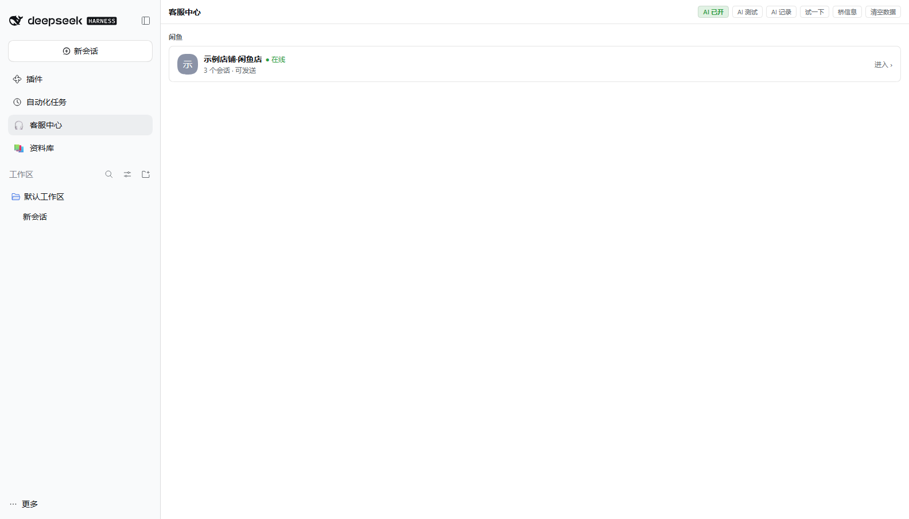
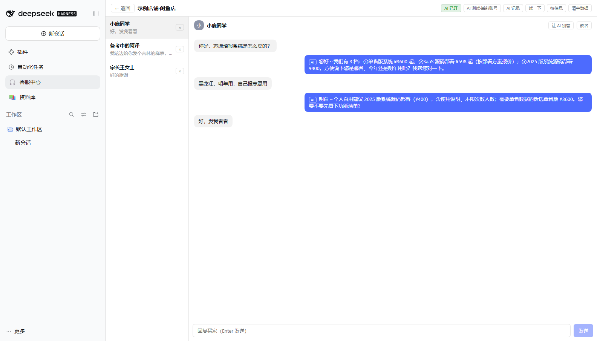
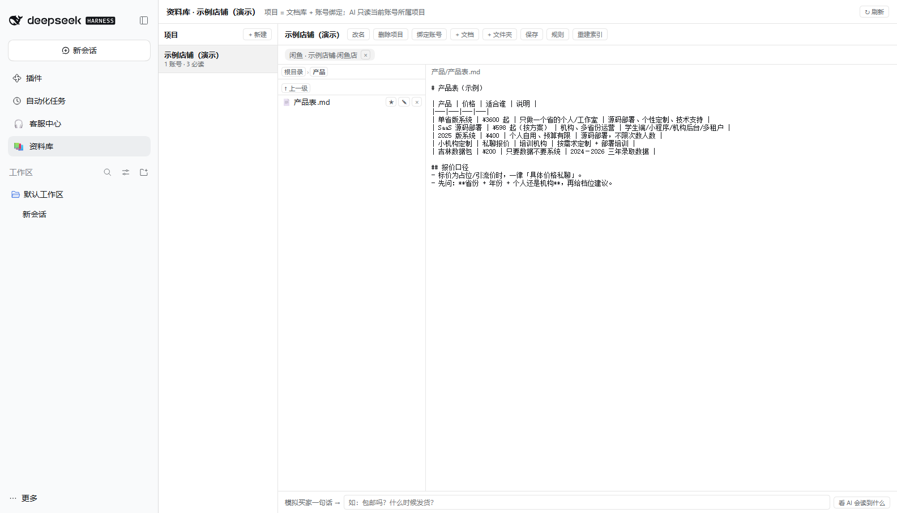
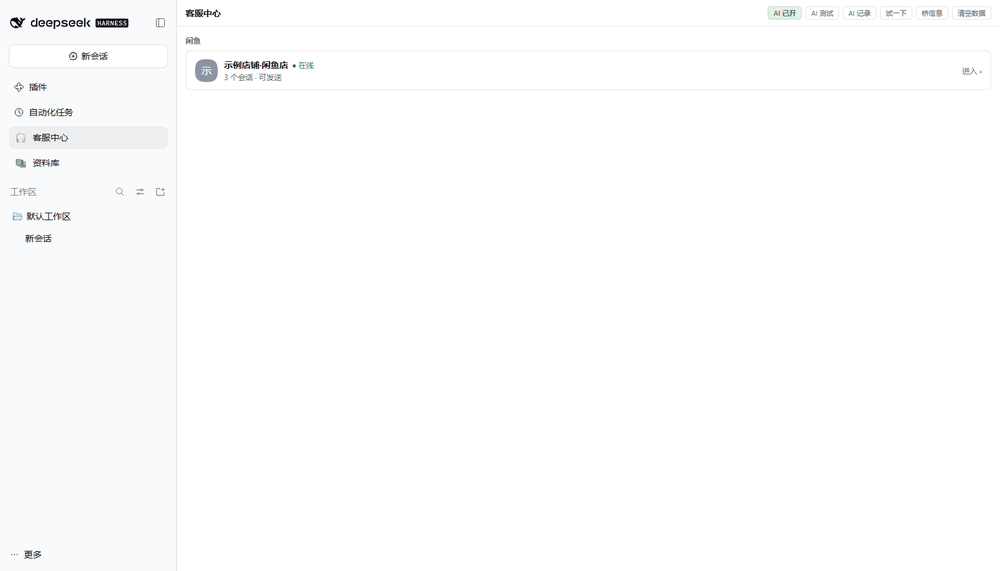

# dsh-customer-service

> 给 **DeepSeek Harness (DSH)** 用的**多平台 AI 客服工作台插件**：
> 用 Chrome 扩展"寄生"在已登录的电商网页上（闲鱼 / 抖音），本地 WebSocket 桥收发消息，
> AI 自动回复（带闸门与审计），客服数据独立存储，并内置一个**可检索的资料库（知识库）**。

<p>
  <a href="./LICENSE"></a>
  
  
</p>

---

## 界面

> 以下截图使用**虚构的演示数据**（示例店铺 / 示例商品），不含任何真实店铺与客户信息。









---

## 这个项目解决什么问题

电商客服的痛点不是"不会回"，而是：

1. 平台消息散落在多个后台，切来切去；
2. 回复要查产品、查店规、查物流，纯手工；
3. 想上 AI，又怕它乱承诺、乱降价、说错话。

这个插件把「平台消息 → 统一工作台 → AI 建议/自动回复 → 人工接管」串成一条本地链路，
并且把"AI 能依据什么回答"收进一个可编辑的资料库（知识库），让 AI **只依据你的资料回答，没写的不瞎编**。

## 功能

**消息链路**
- 闲鱼、抖音（含抖音来客）双平台适配器，统一「平台 → 账号卡 → 工作台」界面
- Chrome MV3 扩展接管已登录页面：**不碰登录、不存 cookie**，所有请求由真人页面发出
- 本地 WebSocket 桥（默认 `127.0.0.1:8765/8766`）+ 配对码握手，多账号/多浏览器 Profile 各自连接
- 收消息、人工回复、发图、未读/人工接管、风控告警

**AI 客服**
- AI 自动回复默认关闭，面板显式开启后生效
- **9 道闸门**：默认关 / 幂等 / 人工优先 / 静默期 / 最小间隔 / 红线 / 结构化输出 / 回读校验 / 审计
- 每次回复都记录：依据的资料、调用的模型、闸门判定、是否转人工
- 「AI 测试」沙箱：不发送、不落会话、不写审计，可看模型原始输出

**资料库（知识库）**
- 项目 = 资料 + 账号绑定；同一平台多账号可绑不同项目
- Markdown 知识文件，按需检索拼 prompt（关键词检索，零外部依赖）
- 每个项目一份 `AGENTS.md` 规则文件，AI 回复前最先读
- 产品表模板、店规模板、话术模板，支持从 Excel 导入产品
- 面板内可直接编辑/新建/移动文档，外部改文件索引自动重建

**闲鱼运营工具（可选，按需启用）**
- 订单 / 交易 / 商品 / 找品 / 发品 / 读页面 / 万能 mtop
- 产品库、客户档案、采集库三套独立存储
- 自动交付（付款后秒发网盘）、曝光体检、话术沉淀

## 架构

```
┌─────────────── 真实浏览器（你已登录账号的 Chrome）───────────────┐
│  goofish.com / douyin.com 页面                                  │
│    ├─ injected.js（MAIN world）hook 页面 WebSocket，截消息帧     │
│    └─ content.js（隔离世界）转发 + 执行 DOM/mtop 动作            │
│  background.js（MV3 SW）：维持到本地桥的 WS、配对、保活 tab      │
└───────────────────────────┬──────────────────────────────────────┘
                            │ ws://127.0.0.1:<port>/ws（配对码握手）
┌───────────────────────────▼──────────────────────────────────────┐
│ DSH 插件（Node，进程内）                                          │
│  lib/kernel/       WS 桥 · 存储 · AI 闸门 · 资料库 · 路由 · 运行时 │
│  lib/platforms/    闲鱼适配器 / 抖音适配器（帧解析、发送通道、工具）│
│  lib/client.js     侧边栏面板：平台卡 → 账号工作台 → 对话         │
└──────────────────────────────────────────────────────────────────┘
```

数据只落本地 `$DSH_HOME/dsh-cs/`，不写 DSH 会话列表、不上传任何地方。

## 目录结构

```
dsh-customer-service/
├─ lib/
│  ├─ index.js               Host 半装配：kernel 启动 + 平台注册 + 路由 + AI 运行时
│  ├─ client.js              Browser 半：客服中心面板
│  ├─ kernel/                公共内核：bridge/store/ai/library/routes/runtime...
│  └─ platforms/
│     ├─ xianyu/             闲鱼适配器（帧解析、发送通道、31 个 mtop 工具、三类存储）
│     └─ douyin/             抖音/来客适配器（protobuf 编解码、来客 DOM 自动化）
├─ extension/
│  ├─ xianyu/                闲鱼 Chrome MV3 扩展
│  └─ douyin/                抖音 Chrome MV3 扩展
├─ docs/                     设计文档、运维手册、知识库模板
├─ test/                     单元 + 契约 + 端到端桩测试（81 个）
└─ cordis.patch.yml          DSH 插件配置
```

## 快速开始

### 0. 前置

- Node.js ≥ 20
- 已安装并运行 **DeepSeek Harness (DSH)**（开发与截图验证环境：`0.2.1-rc.2`）
- Chrome（用于加载扩展并保持账号登录）
- 一个可用的 LLM 配置（DSH 里已配好模型）

### 1. 安装插件

在 DSH 的插件管理器里以本地 bundle 方式安装本仓库目录（`target` 指向仓库根目录），
或把本目录加入 DSH profile 的依赖。安装后在 DSH 侧边栏出现「客服中心」入口。

插件默认配置见 `cordis.patch.yml`：
- 闲鱼桥端口 `8765`，抖音桥端口 `18766`（若你只装这一个插件，可改成 `8766`）
- `ai.enabled: false`：AI 自动回复默认关，面板里显式开启
- 数据目录默认 `$DSH_HOME/dsh-cs/`

### 2. 加载扩展

1. Chrome 打开 `chrome://extensions`，开启右上角「开发者模式」
2. 「加载已解压的扩展程序」→ 选择 `extension/xianyu`（闲鱼）和/或 `extension/douyin`（抖音）
3. 在同一个 Chrome 里登录对应平台账号

### 3. 配对

1. 打开 DSH 客服中心面板，复制配对码（也在 `$DSH_HOME/dsh-cs/pair-code-*.txt`）
2. 点扩展图标 → 填桥地址 `127.0.0.1`、端口（闲鱼 8765 / 抖音 18766）、配对码 → 保存并连接
3. 扩展徽标显示 `ON` 即连接成功；打开消息页开始收消息

### 4. 配置 AI

1. 面板「AI」按钮 → 选模型、开启自动回复（二次确认）
2. 面板「AI 设置」确认读到知识库字数
3. 用「AI 测试」沙箱验证回复质量，再放开自动回复

### 5. 建资料库

1. 侧边栏「资料库」→ 新建项目（如"示例店铺"）
2. 放 Markdown：`AGENTS.md`（规则）、`产品/产品表.md`、`店规速查.md`、`话术.md`
   - 模板见 `docs/knowledge-templates/`
   - 产品表可用 `scripts/import_products.py` 从 Excel 导入
3. 在「客服中心 → 账号卡」绑定项目：AI 回复时按「账号 → 项目」取资料
4. 改文件即生效（约 60s 内或下次检索自动重建索引）

## 配置

`cordis.patch.yml` 关键项：

| 配置 | 说明 |
|---|---|
| `ports.xianyu` / `ports.douyin` | 本地桥端口 |
| `dataDir` | 数据目录，空 = `$DSH_HOME/dsh-cs` |
| `routePrefix` | 面板 HTTP 路由前缀（带鉴权） |
| `ai.enabled` / `ai.model` | AI 自动回复总开关与模型 |
| `notify.*` | 可选 webhook 通知（出单/催货/待评价/风控） |
| `playbook.*` | 可选话术沉淀（自动复盘写回 knowledge） |

环境变量（可选）：

| 变量 | 作用 |
|---|---|
| `DSH_HOME` | DSH 数据根目录 |
| `DOUYIN_CS_SHOP_MCP` | `off` 关闭店铺 MCP 集成 |
| `DOUYIN_CS_SHOP_MCP_SCRIPT` 等 | 接入自定义 stdio MCP 服务（只读） |

## 开发与测试

```powershell
npm test        # 81 个测试：内核/契约/适配器/资料库/AI 闸门/端到端桩
node scripts/fake-ext-e2e.mjs   # 假扩展端到端联调（不需要真浏览器）
```

测试零外部依赖，直接 `node --test` 运行。

## 安全与合规（请务必阅读）

- 本插件**只监听本机回环地址**，配对码握手，不向任何第三方服务器上报数据；
- 扩展**不接管登录、不保存账号密码/cookie**，只是复用你浏览器里已登录的页面；
- 请**只用于你自己的账号**，不要用于骚扰、刷屏、批量营销或任何违反平台规则的行为；
- 插件依赖对平台网页结构与私有协议的适配，属于"非官方客户端"形态，**可能违反平台用户协议**，
  使用与分发风险自负；平台改版可能导致功能失效；
- 仓库内不包含任何真实店铺数据、账号 ID、密钥或用户信息（示例均为占位）。

## 已知限制

- 依赖页面结构/私有协议：平台改版后需更新 `extension/*` 与对应适配器；
- 浏览器完全退出时收不到消息（扩展能力边界）；
- 同一 `$DSH_HOME/dsh-cs` 只允许一个 DSH 实例写；
- 资料库检索目前是关键词检索（无向量检索），超大知识库需要自行拆分。

## 文档

| 文档 | 内容 |
|---|---|
| [docs/OPERATIONS.md](docs/OPERATIONS.md) | 运维手册：日常操作、备份、联调清单 |
| [docs/KNOWLEDGE-LIBRARY-DESIGN.md](docs/KNOWLEDGE-LIBRARY-DESIGN.md) | 资料库设计：项目 / 账号绑定 / 检索 |
| [docs/AGENTS-AND-KNOWLEDGE-RULES.md](docs/AGENTS-AND-KNOWLEDGE-RULES.md) | AGENTS 规则层与知识口径 |
| [docs/M3-AI-AND-NOTIFY.md](docs/M3-AI-AND-NOTIFY.md) | AI 闸门、自动交付、通知 |
| [docs/M4-TOOLS.md](docs/M4-TOOLS.md) | 闲鱼工具层清单 |
| [docs/M1-INTERFACES.md](docs/M1-INTERFACES.md) | 内核与适配器接口 |
| `docs/knowledge-templates/` | 产品表 / 店规 / 话术 模板 |

## 致谢

- 协议与实现思路参考了作者的早期内部实现（Hermes 插件）与 DSH 官方插件规范；
- 感谢 DSH 提供的插件运行时与 UI 扩展点。

## License

[MIT](./LICENSE)
